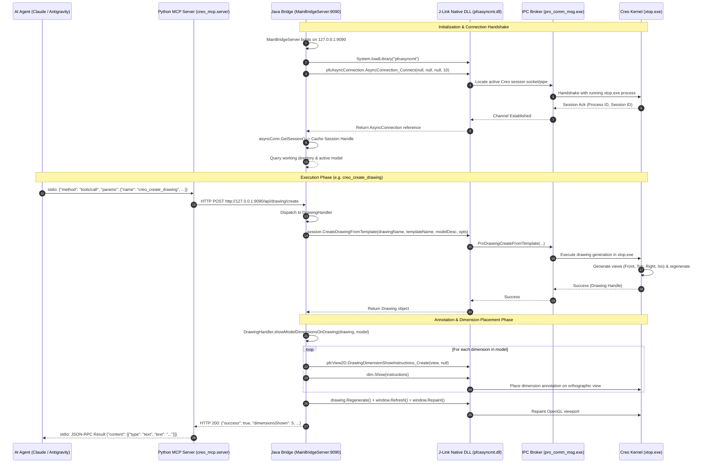
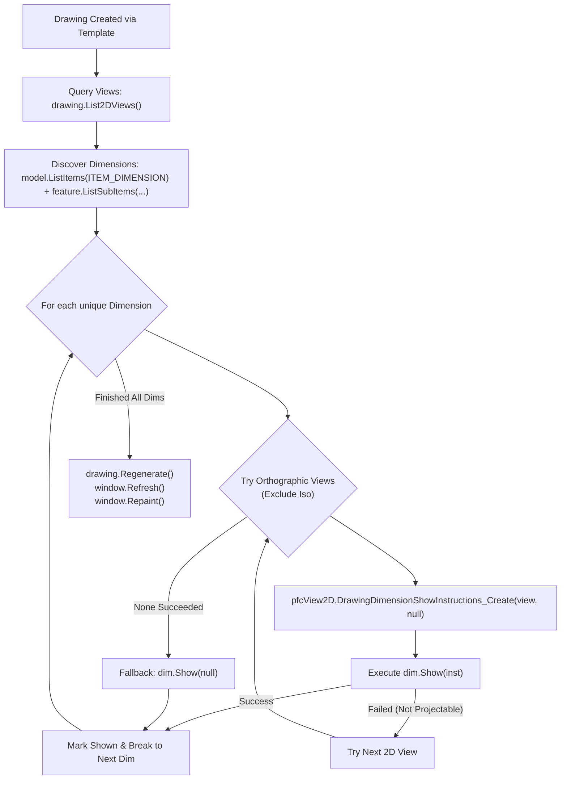

# Creo MCP & Java Bridge: System Architecture & Transaction Specification

This document provides a comprehensive, rigorous technical breakdown of the **Creo MCP Architecture**. It details how AI agents (Claude Desktop, Antigravity, Cursor, ChatGPT) connect, transact, and execute out-of-process CAD operations against **PTC Creo Parametric**.

---

## 1. System Architecture Overview

The system is architected as an **out-of-process, two-tier decoupled bridge** that abstracts the proprietary C++/COM/JNI internals of PTC Creo into a clean, modern **Model Context Protocol (MCP 2.x)** interface.

```
┌────────────────────────────────────────────────────────────────────────┐
│               TIER 0: AI Agent Host Environment                       │
│  (Claude Desktop, Antigravity Agent, Cursor, Cline, Custom Agents)     │
└───────────────────────────────────┬────────────────────────────────────┘
                                    │ JSON-RPC 2.0 via Standard I/O (stdio)
                                    ▼
┌────────────────────────────────────────────────────────────────────────┐
│               TIER 1: Python MCP Server (mcp-server)                   │
│                                                                        │
│   • creo_mcp.server (MCPServer @ mcp 2.3.0+)                           │
│     - 17 CAD Tools registered with JSON Schema metadata               │
│     - Stdio transport loop (async event loop)                          │
│                                                                        │
│   • creo_mcp.client (CreoBridgeClient)                                 │
│     - HTTP Connection Pool (httpx with connection keep-alive)          │
│     - Automatic retry, timeout arbitration & error normalization       │
└───────────────────────────────────┬────────────────────────────────────┘
                                    │ HTTP/1.1 REST (JSON Payload) @ 127.0.0.1:9090
                                    ▼
┌────────────────────────────────────────────────────────────────────────┐
│               TIER 2: Standalone Java Bridge (java-bridge)             │
│                                                                        │
│   • MainBridgeServer (JDK com.sun.net.httpserver @ port 9090)         │
│     - Multi-threaded Executor (4 daemon worker threads)                │
│     - CORS, BaseHandler dispatcher, Jackson JSON serialization         │
│                                                                        │
│   • CreoSessionManager (Singleton Connection Controller)               │
│     - J-Link native library loader (pfcasyncmt.dll)                    │
│     - Session connection lifecycle & state recovery                    │
│     - CIP (Common Interface Platform) exception translator             │
│                                                                        │
│   • Domain Handlers                                                    │
│     - ConnectionHandler    (/api/status, /api/connect, /disconnect)    │
│     - ModelHandler         (/api/model/active, /list, /open, /save...) │
│     - ParameterHandler     (/api/parameter/list, /get, /set, /delete)  │
│     - FeatureHandler       (/api/feature/list)                         │
│     - DrawingHandler       (/api/drawing/create, /show_dimensions)     │
│     - ExportHandler        (/api/export/step, /api/export/pdf)         │
└───────────────────────────────────┬────────────────────────────────────┘
                                    │ JNI Native Calls (In-Process JVM to C++)
                                    ▼
┌────────────────────────────────────────────────────────────────────────┐
│               TIER 3: PTC Creo J-Link Native Subsystem                 │
│                                                                        │
│   • pfcasync.jar: Java CIP Interfaces (com.ptc.pfc.*)                  │
│   • pfcasyncmt.dll: Native C++ Multi-Threaded J-Link Wrapper           │
│   • pro_comm_msg.exe: PTC IPC Communication Arbiter (Shared Mem/Pipe)  │
└───────────────────────────────────┬────────────────────────────────────┘
                                    │ Proprietary Inter-Process Communication
                                    ▼
┌────────────────────────────────────────────────────────────────────────┐
│               TIER 4: PTC Creo Parametric Kernel                       │
│                                                                        │
│   • xtop.exe: Core Creo CAD Modeler Process                            │
│     - Parametric Feature Engine & Geometry Evaluator                   │
│     - Drawing / Drafting Layout Engine & Annotation Generator          │
│     - OpenGL Viewport & Graphics Pipeline                              │
└────────────────────────────────────────────────────────────────────────┘
```

---

## 2. Process Boundary & Connection Mechanics

Connecting an external process to PTC Creo requires bridging multiple operating system and runtime boundaries.



### 2.1 The Connection Handshake in Detail
1. **DLL Loading**:
   * The Java Bridge dynamically locates `<Creo_Common_Files>\x86e_win64\lib\pfcasyncmt.dll` and `<Creo_Common_Files>\x86e_win64\obj\pro_comm_msg.exe`.
   * Both directories are appended to Windows `PATH` prior to invoking `java.exe`.
   * `System.loadLibrary("pfcasyncmt")` binds the native JNI entry points into the Java Virtual Machine.
2. **IPC Arbiter Connection**:
   * `pfcAsyncConnection.AsyncConnection_Connect(display, proe_path, text_path, timeout_seconds)` executes.
   * Passing `null` for display and executable path signals J-Link to discover and attach to the **already-running Creo Parametric process** on the local desktop.
   * `pro_comm_msg.exe` serves as the IPC arbiter. If another J-Link client is already latched to Creo, Creo raises an `XToolkitCantModify` mutex exception.
3. **Session Acquisition**:
   * Once connected, `AsyncConnection.GetSession()` returns a live `com.ptc.pfc.pfcSession.Session` object.
   * This object serves as the root gateway for all CAD operations (Model retrieval, Window management, Parameter ownership, Feature queries, and Export execution).

---

## 3. Transaction & Execution Architecture

Every action requested by an AI assistant flows through a strictly validated transaction pipeline.

### 3.1 Tier-by-Tier Request Lifecycle

```
[Agent Prompt] 
   │
   ▼
[Tier 1: MCP Server]
   ├─ Deserializes JSON-RPC tool invocation
   ├─ Validates arguments using Python type hints & Pydantic
   └─ Calls CreoBridgeClient (HTTP Client)
   │
   ▼
[Tier 2: Java Bridge REST Layer]
   ├─ BaseHandler validates HTTP method (GET/POST)
   ├─ Reads UTF-8 request body and parses via Jackson ObjectMapper
   ├─ Checks CreoSessionManager connection status (auto-connects if disconnected)
   ├─ Dispatches to Domain Handler
   │
   ▼
[Tier 3: Domain Logic & J-Link Invocation]
   ├─ Resolves target Model (by name or active window)
   ├─ Executes native CIP calls
   ├─ Converts native exceptions into structured JSON error payloads
   └─ Formats success payload with updated model state
   │
   ▼
[Tier 4: Creo Kernel Execution]
   ├─ Modifies CAD feature tree / regenerates B-Rep geometry
   ├─ Updates drafting tables and annotation view placements
   └─ Repaints active OpenGL viewport
```

### 3.2 The J-Link 31-Character String Constraint & In-Memory Staging
A major architectural hurdle identified during reverse-engineering:
* **The Problem**: In PTC's underlying C++ Pro/TOOLKIT kernel, entity names and template identifiers are typed as fixed-width `ProName` buffers (maximum **31 characters**).
* Passing absolute file paths (such as `C:\Program Files\PTC\Creo 9.0.10.0\Common Files\templates\c_drawing.drw`, 78 characters) into `session.CreateDrawingFromTemplate()` triggers an immediate native crash: `com.ptc.cipjava.jxthrowable: XStringTooLong`.
* **The Solution**: Our [`DrawingHandler.java`](file:///C:/Users/tanan/CREO_MCP/creo_mcp/java-bridge/src/com/creomcp/bridge/handler/DrawingHandler.java) implements **Dynamic In-Memory Staging**:
  1. It discovers the requested template (either custom or from Creo's `Common Files/templates`).
  2. If the template resides outside Creo's active working directory, it safely copies the template into Creo's current workspace directory.
  3. It strips directory paths and extensions, passing only the clean identifier (e.g. `c_drawing`, 9 characters) to J-Link.
  4. Creo locates the template instantaneously in its workspace without violating buffer length constraints.

### 3.3 Automatic 2D Dimension Projection Engine
Model annotations (driving dimensions) are authored in 3D solid features and do not automatically appear when 2D views are spawned. The drawing dimension engine implements the following pipeline:



---

## 4. Concurrency, Threading & Process Safety Model

| Concern | Resolution Strategy |
| :--- | :--- |
| **Creo UI Single-Threaded Nature** | PTC Creo's kernel (`xtop.exe`) processes CAD model operations sequentially. The Java Bridge uses a controlled thread pool (`Executors.newFixedThreadPool(4)`) with synchronized access across critical J-Link model modification pipelines to prevent race conditions. |
| **Native Fault Isolation** | If a corrupt CAD file or invalid feature operation occurs, J-Link throws a CIP `jxthrowable` subclass (e.g., `XToolkitNotFound`, `XToolkitBadContext`). The Java Bridge traps these at `BaseHandler`, serializes the CIP error code, and returns HTTP 200 with `{"success": false, "error": true, "message": "..."}`. The JVM and MCP stdio streams remain 100% stable. |
| **Process Crash Resilience** | If the Creo GUI is closed by the user, `CreoSessionManager` detects the dead socket on the next transaction, flags `connected = false`, and attempts an automatic re-handshake without restarting the MCP server or Java daemon. |

---

## 5. Network & Protocol Specifications

### 5.1 Python MCP Server (`stdio` Transport)
* Protocol: **JSON-RPC 2.0** over Standard Input / Standard Output.
* Framework: `mcp.server.mcpserver.MCPServer` (MCP SDK 2.3.0+).
* Serialization: Standard JSON UTF-8 with Pydantic tool schemas.

### 5.2 Java Bridge HTTP Server (`http://127.0.0.1:9090`)
* Protocol: **HTTP/1.1 RESTful JSON API**.
* Server: `com.sun.net.httpserver.HttpServer` (zero external web containers; embedded JDK lightweight server).
* Headers:
  * `Content-Type: application/json; charset=UTF-8`
  * `Access-Control-Allow-Origin: *`
* Serialization: FasterXML Jackson `ObjectMapper` (packaged in `lib/`).

---

## 6. End-to-End Component Matrix

| Module | Language / Runtime | Responsibilities | Key Dependencies |
| :--- | :--- | :--- | :--- |
| **`mcp-server`** | Python 3.10+ | LLM Agent tool interface, input schema validation, HTTP client proxy. | `mcp`, `httpx`, `pydantic` |
| **`java-bridge`** | Java 17 (OpenJDK) | HTTP routing, J-Link session arbitration, CAD domain command dispatch. | `pfcasync.jar`, `jackson-databind` |
| **`pfcasyncmt`** | C++ Native DLL | Native JNI bridge into PTC's asynchronous IPC message broker. | Creo Common Files native runtime |
| **`pro_comm_msg`** | Native Win32 Executable | IPC message router communicating with active Creo process. | PTC Creo System Component |
| **`xtop.exe`** | C++ Native Application | Core PTC Creo Parametric modeling engine and OpenGL viewport. | PTC Creo Parametric 9.0+ |
